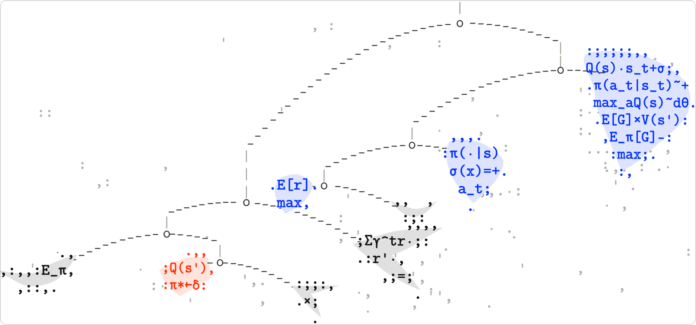

<p align="center">
  
</p>

# Atelier

*a-tə-lye · proper noun.* A research workshop for people exploring unconventional ideas in robot learning.

This is the homepage for [atelierlab.io](https://atelierlab.io): a single quiet page of text, with a
sculpture hanging beside it.

## The sculpture

The mobile is after Alexander Calder, inspired by his
[*Model for East Building Mobile*](https://www.nga.gov/artworks/55697-model-east-building-mobile) (1972)
at the National Gallery of Art. It is not an animation but a small simulation of a real one:

- **Balanced.** Each wire arm hangs from a hook at its true balance point, computed from the
  masses below it, so the arrangement can be edited freely and always hangs level.
- **Moving.** Every arm twists on its hook as a torsional pendulum, pushed by a slow, swirling
  air current and damped by the drag of its sheets. Moving the cursor across it stirs a breeze;
  clicks send puffs that build into a gust. Firm limits keep it from ever swinging into the text.
- **Printed.** It is drawn in characters on a canvas. Each sheet is a grid of reinforcement-learning
  notation, `π(a|s)`, `E[Σγ^tr_t]`, `θ←θ+α`, that swaps term for term as the sheet turns, and casts a
  faint shadow of dots on the wall behind it.
- **Still while reading.** Scroll down and it settles into an open pose and holds perfectly still,
  letters included, until someone stirs it again.

## Running it

```bash
npm install
npm run dev     # http://localhost:3000
npm run build
```

## How it is put together

| File | What it holds |
| --- | --- |
| `components/Copy.tsx` | The page text and its footnotes. |
| `app/layout.tsx` | Title, description and share image metadata. |
| `app/globals.css` | Fonts, the light and dark palettes (including the sculpture's `--mobile-*` colors), and placement. |
| `components/mobile/config.ts` | Every tuning knob: the arrangement of arms and sheets, periods, damping, air, breeze and gusts, swing limits, camera, layout, and the ASCII look. |
| `components/mobile/physics.ts` | Balance points, inertia and the simulation. |
| `components/mobile/shapes.ts` | The hand-cut sheet outlines. |
| `components/mobile/engine.ts` | Camera, placement beside or above the text, the air field, input and the animation loop. |
| `components/mobile/draw-ascii.ts` | Prints the sculpture in characters. |
| `app/thumbnail/page.tsx` | The sculpture alone and still at 1200 × 630, which `app/opengraph-image.png` is captured from. |

The sculpture hangs to the right of the text on wide screens and above it on narrow ones,
always sized so that no reachable pose can cross into the text.

## Type

The page is set in FK Roman Standard, by Florian Karsten Typefaces, used only from a local installation (the trial license does not cover serving it), and falls back to Times New
Roman. The sculpture is printed in CMU Typewriter, from the
[`computer-modern`](https://www.npmjs.com/package/computer-modern) package.
